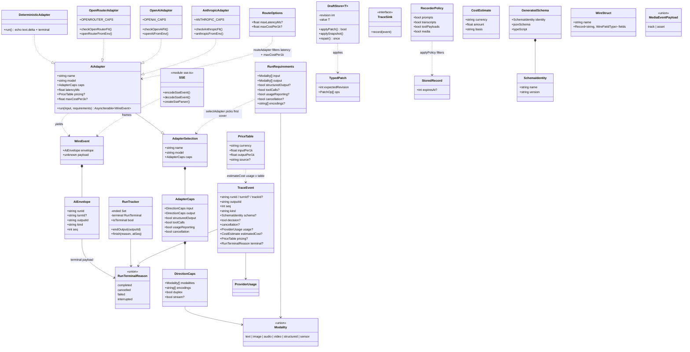
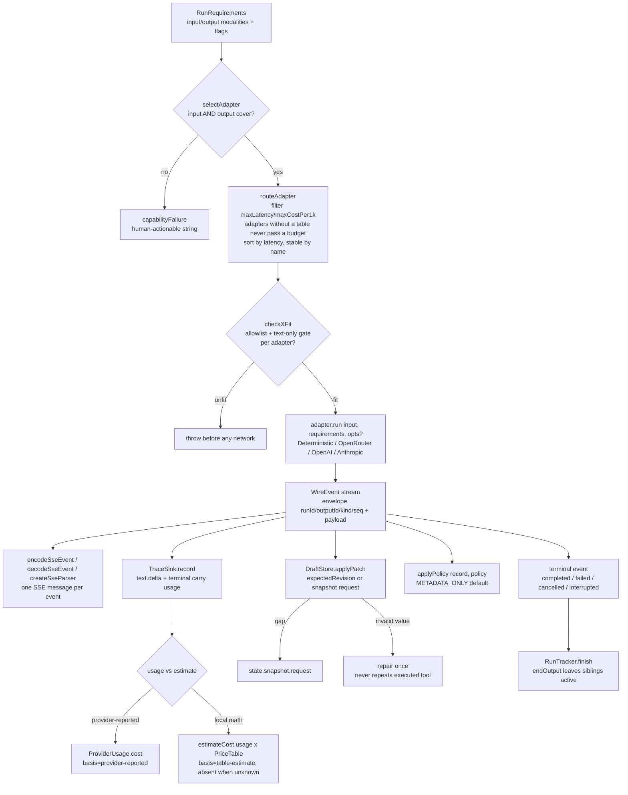

# `@swelte/ai` — `src/lib` concept map

Browser-safe library surface (no `node:*` imports — see `version.ts`). The package
boundary is `src/lib/index.ts`; `src/routes/` is dogfood and never published.
`@swelte/media` is an optional peer — only `media.ts` / `boundary.ts` may touch
media shapes, and only as structural contracts.

| module | owns | key exports |
|---|---|---|
| `envelope.ts` | run skeleton: envelope, kinds, terminal lifecycle | `AiEnvelope`, `AI_BUILTIN_KINDS`, `isBuiltinKind/isAppKind/isKnownKind`, `validateEnvelope`, `RunTerminalReason`, `RunTracker` |
| `capabilities.ts` | capability advertisement + selection | `Modality`, `DirectionCaps`, `AdapterCaps`, `RunRequirements`, `AdapterSelection`, `selectAdapter`, `capabilityFailure` |
| `adapters.ts` | `AiAdapter` contract + latency/budget routing + offline adapter | `AiAdapter`, `CostModel`, `RouteOptions`, `routeAdapter`, `DeterministicAdapter` |
| `openrouter.ts` | 1st network adapter (chat-completions SSE) | `OpenRouterAdapter`, `OPENROUTER_CAPS`, `checkOpenRouterFit`, `openRouterFromEnv` |
| `openai.ts` | 2nd network adapter (Responses SSE, native stored usage) | `OpenAiAdapter`, `OPENAI_CAPS`, `checkOpenAiFit`, `openAiFromEnv` |
| `anthropic.ts` | 3rd network adapter (Messages SSE) | `AnthropicAdapter`, `ANTHROPIC_CAPS`, `checkAnthropicFit`, `anthropicFromEnv` |
| `sse.ts` | wire framing: one envelope + payload per SSE message | `WireEvent`, `encodeSseEvent`, `decodeSseEvent`, `createSseParser` |
| `draft.ts` | progressive UI state: revisioned patches, snapshot, 1 bounded repair | `DraftStore`, `TypedPatch`, `PatchOp`, `DraftSnapshot` |
| `trace.ts` | observability: sink, usage vs. estimate kept distinct | `TraceEvent`, `TraceSink`, `createMemorySink`, `estimateCost`, `ProviderUsage`, `CostEstimate`, `PriceTable` |
| `recorder.ts` | retention policy: metadata by default, opt-in slices | `RecorderPolicy`, `METADATA_ONLY`, `StoredRecord`, `applyPolicy`, `redactForPolicy` |
| `schema.ts` | versioned shape identity for tools / outputs / app events / trace | `SchemaIdentity`, `schemaId`, `WireStruct`, `GeneratedSchema`, `generateSchema` |
| `boundary.ts` | media type contracts only — never imports `@swelte/media` | `MediaTrackRef`, `MediaAssetRef`, `MediaEventPayload`, `isTrackPayload` |
| `media.ts` | Phase-D placeholder entry point (`@swelte/ai/media`) | `assertMediaReady` (throws until implemented) |
| `version.ts` | browser-safe version constant | `VERSION` |
| `index.ts` | public re-export surface | everything above (minus dogfood) |

## Static structure

## Runtime flow (one text run)

## Layering rules (read the diagram this way)

- `envelope` + `capabilities` are the base — everything points at them, they
  point at nothing.
- `adapters` + the three network adapters depend on `capabilities` (fit gate),
  `envelope` (terminal reason) and `sse`/`trace` (event + usage types).
- `sse` frames what adapters yield; `trace` observes it; `draft` / `recorder` /
  `schema` consume it. None of them import each other (except `trace` -> `schema`
  for the `SchemaIdentity` field type).
- `boundary` is type-only; `media` re-exports it and throws until Phase D.
- `index.ts` re-exports the public surface only — consumer demos (e.g. the
  `examples/shell` approval helper in its own `src/lib/`) are never imported
  from `#lib`.
